# Audit — Composition et design du site d'origine

> Volet « DESIGN » de l'audit de `https://www.thomaslepeltier.fr/` en vue de la refonte (Eleventy).
> Date de l'audit : 23 octobre 2026. Auteur : fork « design » de l'audit.
> Légende des sévérités : **critique** (bloque ou dégrade gravement l'usage), **majeur** (gêne réelle, à corriger dans la refonte), **mineur** (confort, finition).

---

## 0. Périmètre, méthode et réserves

**Ce qui a été audité.** Le site vivant `www.thomaslepeltier.fr` (hébergé sur Vercel, `thomas.lepeltier.free.fr` n'étant plus qu'une page de redirection), aspiré le 23/10/2026 : 590 pages HTML réelles, 1 463 images, 1 feuille de style externe et 1 script (`recherche-moteur.js`). Le site a été servi localement et mesuré avec Chromium headless (Puppeteer) à **1440, 768 et 390 px**, sur les 16 types de pages (accueil, qui-suis-je, livres, fiche livre, table des matières, articles, conférences, contact, index par auteur, compte rendu, annexe, recherche, liste des publications, annexe longue, article « lecture », débats).

**Point d'attention important : le site vivant n'est déjà plus l'état d'origine de juin.**
L'en-tête de `styles_new.css` (« Révision de septembre 2026, deuxième passe — modernisation ») documente une première modernisation : Times New Roman 18 px → Charter/Georgia 19 px, interligne 18 pt → 1,65, orange `#ffae15` → sable `#EBD79B`, cadres orange → crème `#FFF8D9`, bandeaux argent → beige, liens `#061DF9` → `#1449c4`, rayons 25 px → 14 px, ombres noires 4/4/4 → diffuses, fond blanc → papier `#F4EEE0`, vignettes « étirées → recadrées », couverture de CR « recadrée → entière ». La feuille d'origine (`styles.css`, 1 366 octets, *Times New Roman 16 px, `.principal` 700/800 px fixes, fond `#ffe187`, menu `#ffae15`*) n'est plus servie.
Conséquence : **l'« identité » à préserver est celle de cette version de septembre 2026** (papier chaud, cadres crème, serif, couvertures en vignettes), qui prolonge l'identité d'origine (jaune/orange chaud, Times, cadres arrondis, couvertures en grille) sans la trahir. Le « daté » est ce que cette modernisation n'a pas traité (voir §4 et §5).

**Réserves de mesure.**
- Les polices `Charter` et `Georgia` n'existent pas sur la machine d'audit (Linux) : les captures montrent le *fallback* (Liberation Serif ≈ Times pour le serif, Noto Sans pour `system-ui`). Les proportions typographiques sont donc indicatives ; le constat DES-07 en tient compte.
- La recherche (`recherche.html?de=…`) s'est correctement exécutée sur le site réel (17 résultats pour « univers ») ; elle ne fonctionne pas sur le miroir local parce que les fichiers y sont nommés avec un `?` (artefact d'aspiration, pas un défaut du site).
- Les deux pages encore en feuille `styles_new.css` (`articles/lecture/*.html`) servent de témoin du « design intermédiaire » ; il n'existe plus de page dans le design de juin.

**Captures.** `docs/audit/img/design-*.png` (15 fichiers, référencés ci-dessous). Données brutes : `/tmp/audit_out/measure.json` (non versionné).

---

## 1. Synthèse

| Indicateur | Valeur mesurée |
|---|---|
| Pages réelles / types de gabarits | 590 pages ; 1 gabarit CSS « maquette » (588 pages) + 1 ancien (2 pages) |
| Feuille de style partagée | **Aucune** : le CSS (≈ 250–480 lignes) est recopié en `<style>` dans chaque page (`index.html:36-232`) |
| Débordement horizontal | **Aucun** (0/48 mesures) — le responsive est solide |
| Polices | 2 familles (`Charter, Georgia` + `system-ui`), **aucune police embarquée** |
| Corps de texte | 19 px / interligne 1,6 (30,4 px) ; 18 px sur mobile |
| Menu | 6 liens + loupe ; 63 px (bureau), 96 px (tablette), **137 px (mobile, 3 lignes)** |
| Vignettes déformées (> 5 % de rapport) | **315 / 884** (36 %) ; > 10 % : 128 ; > 15 % : 48 |
| Page la plus lourde en images | `articles.html` : **64,4 Mo**, 165 images, 305 liens, 22 772 px de haut (bureau) / 33 876 px (mobile) |
| Images avec `width`/`height` | **0 %** sur les pages à grilles (CLS) |
| Images avec `alt` | 100 % (1 463), dont 6 vides ; 5 alt = nom de fichier |

**Verdict.** Le site est **sobre, lisible et cohérent à 98 %** (même barre, même pied, mêmes jetons). Sa faiblesse n'est pas l'esthétique mais l'**architecture visuelle** : un titre `h1` identique partout qui écrase le titre réel, des pages-listes interminables et très lourdes, des vignettes déformées, des cartes sans titre ni page cible, une typographie qui dépend des polices de l'utilisateur, aucun composant factorisé. La refonte doit **garder l'ambiance et corriger la structure**.

**Score ux-heuristics (grille Nielsen + Krug) : 6/10** — aucune tâche bloquée, mais plusieurs lignes du diagnostic échouent au niveau « majeur » : H4 cohérence (deux gabarits), H6 reconnaissance plutôt que rappel (couvertures sans titre), H8 design minimaliste (titre de site répété, pages-fleuves), H1 visibilité (pas de fil d'Ariane ni de page courante dans le contenu), « Don't make me think » (liens-images vers des JPG). Chemin vers 10/10 : DES-01 à DES-06, DES-10, DES-11.

---

## 2. Jetons de design actuels (mesurés)

### 2.1 Typographie

| Élément | Valeur actuelle | Source |
|---|---|---|
| Serif (corps, titres) | `Charter, Georgia, "Times New Roman", serif` — **non embarquée** | `index.html:41` |
| Sans (menu, légendes, pied) | `system-ui, -apple-system, "Segoe UI", Roboto…` | `index.html:42-43` |
| Corps | 19 px (≥ 761 px), 18 px (≤ 760 px), interligne 1,6 | `index.html:55-59`, `:168` |
| h1 (titre du site) | `clamp(27px, 4.2vw, 50px)`, `white-space: nowrap` (bureau) | `index.html:105-109` |
| h2 (titre de page / section) | `clamp(21px, 2.3vw, 28px)` | `index.html:128-131` |
| Menu | 0,8 em ≈ 15,2 px, sans | `index.html:89-90` |
| Légendes / pied | 0,68–0,78 em ≈ 13–15 px, sans | `index.html:86`, `:161`, `:163` |
| Mesure (caractères/ligne) | CR 76, fiche 51, annexe 85, annexe longue 84, débats 84, **liste des publications 98** | `measure` du relevé |
| Alignement | Titres à gauche ; **corps justifié + `hyphens: auto`** (fiches, CR, annexes) ; métadonnées de CR **centrées** ; `text-indent: 40px` | `darwin-heretique.html:265`, `cr/gilson.html:265` |

### 2.2 Palette

| Rôle | Valeur | Contraste mesuré |
|---|---|---|
| Fond « papier » | `#F4EEE0` | — |
| Cadres « crème » (barre, pied, cartes de texte) | `#FFF8D9` | — |
| « Sable » (boutons, onglet actif, pastilles) | `#EBD79B` | — |
| Encre | `#2B2721` | 12,83:1 sur papier ; 13,91:1 sur crème ✅ |
| Chapeau | `#4A4437` | 8,35:1 ✅ |
| Gris secondaire | `#6B6355` | 5,13:1 papier ; 5,56:1 crème ; **4,16:1 sur sable ❌ (< 4,5)** |
| Lien | `#1449c4` | 6,53:1 papier ; 7,08:1 crème ; 5,30:1 sable ✅ |
| Rouge d'étiquette (« En librairie… », « Pour acheter… ») | `#b3121d` | 6,01:1 papier ✅ |
| Filet « trait » | `#E0D6C2` | 1,25:1 sur papier (décoratif, non exigé) |
| Pastille désactivée (lettre X) | `#A8A093` | 2,24:1 (composant désactivé : exempté) |
| Orange d'origine | `#ffae15` | 1,60:1 sur papier ; liens `#061DF9` dessus : 4,44:1 ❌ (c'est pourquoi il a été supprimé) |

**Lien contre texte courant** : `#1449c4` vs `#2B2721` = **1,96:1** — insuffisant pour distinguer un lien par la seule couleur (cf. DES-05).

### 2.3 Forme et mouvement

Rayons 8 px (pastilles), 10 px (vignettes), 14 px (cadres) ; ombres diffuses `0 4px 12px rgba(0,0,0,.16)` ; barre collante translucide (`backdrop-filter: blur(6px)`) ; survol des cartes `translateY(-3px)` en 0,16 s (propriété ciblée, pas de `transition: all` ✅) ; **aucune règle `prefers-reduced-motion`**, **aucun `:focus-visible`** dans aucune des 590 pages.

### 2.4 Mise en page

Conteneur `.largeur` : 1120 px max, 24 px de gouttière (16 px mobile). Grilles de vignettes : 4 colonnes (accueil, conférences), 5 colonnes (livres), 2 colonnes ≤ 560 px. Un seul point de rupture réel (760 px) plus 560 px et 1 060 px sur les fiches.

---

## 3. Structure de chaque type de page

### 3.1 Cadre commun (toutes les pages « maquette »)

Barre collante (`.barre`, crème, 63 px) : marque « Thomas Lepeltier / L'UNIVERS LIVRESQUE » à gauche, 6 liens + loupe à droite ; puis **bandeau `h1` « L'univers livresque de Thomas Lepeltier » + chapeau « Essayiste, travaillant sur… »** ; puis `<main>` ; puis pied crème avec **la même navigation répétée** et la signature. Hiérarchie visuelle : (1) h1 géant en tête, (2) titre de page h2 nettement plus petit, (3) contenu. **Le titre de la page est donc deux fois moins grand que le nom du site, répété à l'identique sur 590 pages** (DES-03).

### 3.2 Accueil — 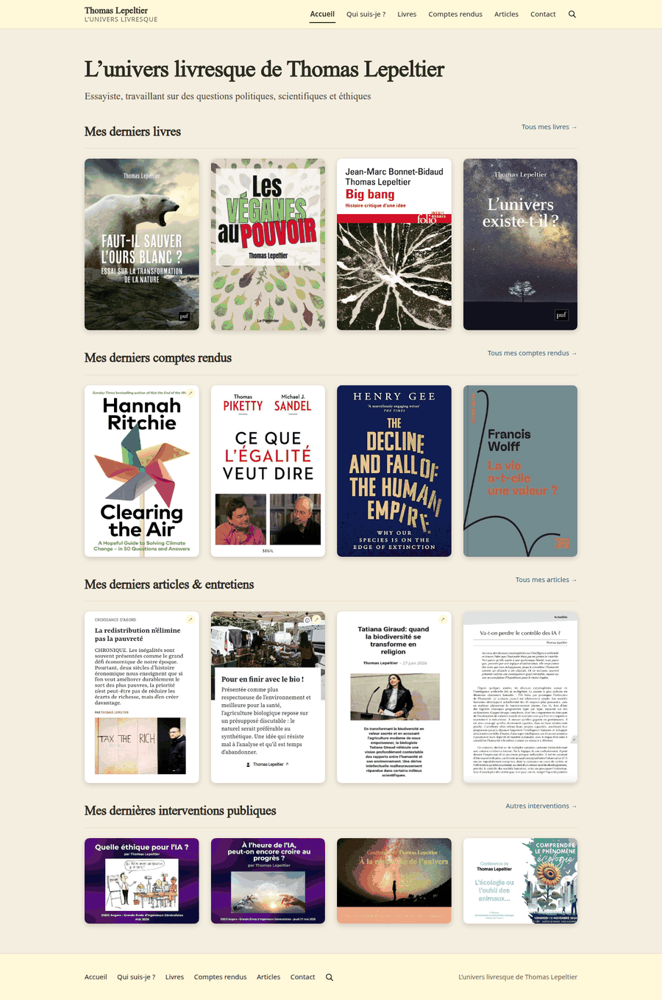

Quatre bandes identiques : *Mes derniers livres* (4 couvertures), *Mes derniers comptes rendus* (4), *Mes derniers articles & entretiens* (4 premières pages scannées), *Mes dernières interventions publiques* (4 affiches 4:3), chacune avec un filet et un lien « Tous… → » à droite (sous les images sur mobile). Aucun hero image, aucune biographie, aucun appel à l'action, aucune mention de la disponibilité pour des conférences. Mobile (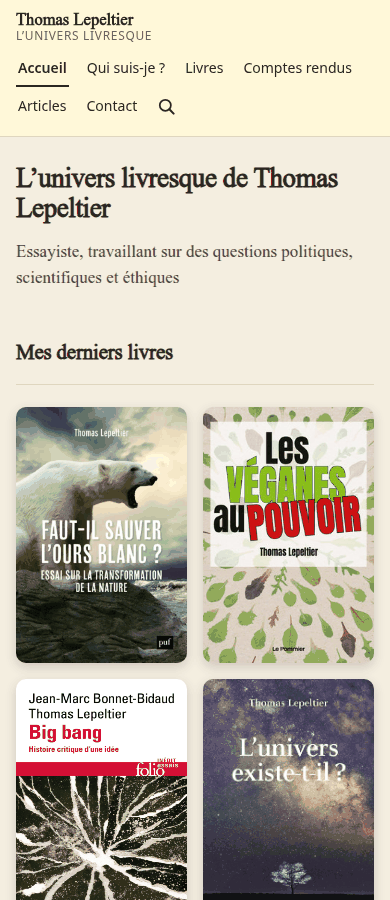) : grille 2×2, **le premier contenu commence à ≈ 340 px** de haut (barre 137 px + h1 sur 2 lignes + chapeau).
Poids : 16 images, 4,0 Mo, dont `couverture-big-bang.jpg` (2,2 Mo, 1276×2102 affichée à ≈ 250 px).

### 3.3 Qui suis-je — 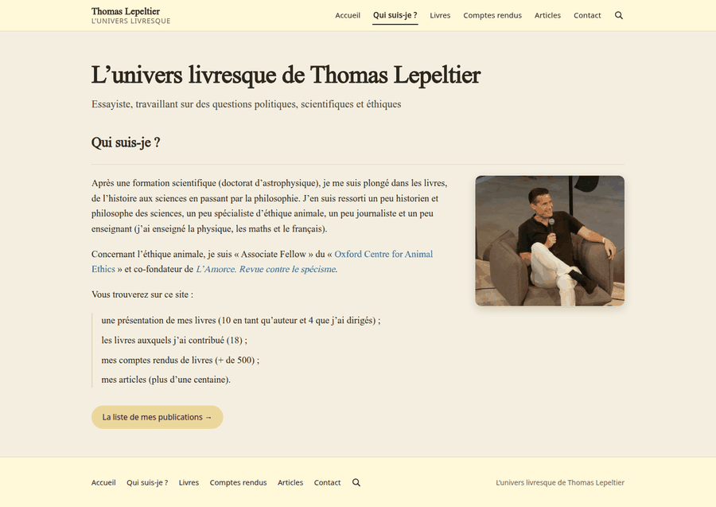

Deux colonnes : texte (≈ 77 signes/ligne) à gauche, photo (300 px, ombre portée) à droite ; liste à filet sable ; bouton sable « La liste de mes publications → ». 182 mots. C'est la page la plus « humaine » mais elle reste un texte unique, sans titres intermédiaires, sans affiliations mises en avant, sans chronologie.

### 3.4 Livres — 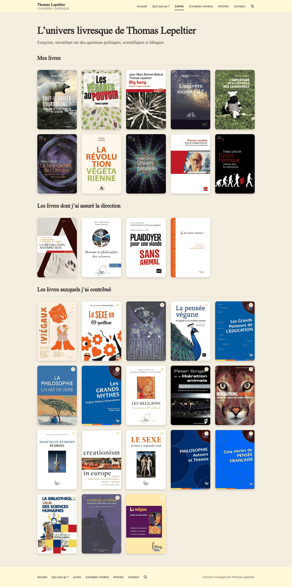

Trois sections h2 (Mes livres 10 · dirigés 4 · contribué 18), grille 5 colonnes de couvertures **sans titre ni année visibles** (le moteur de recherche le reconnaît : « livres.html n'affiche que des couvertures, sans titre »). Les 18 contributions portent la pastille ↗ (lien externe) ; les livres de l'auteur mènent à une fiche interne. 6,5 Mo, 32 images.

### 3.5 Fiche livre — 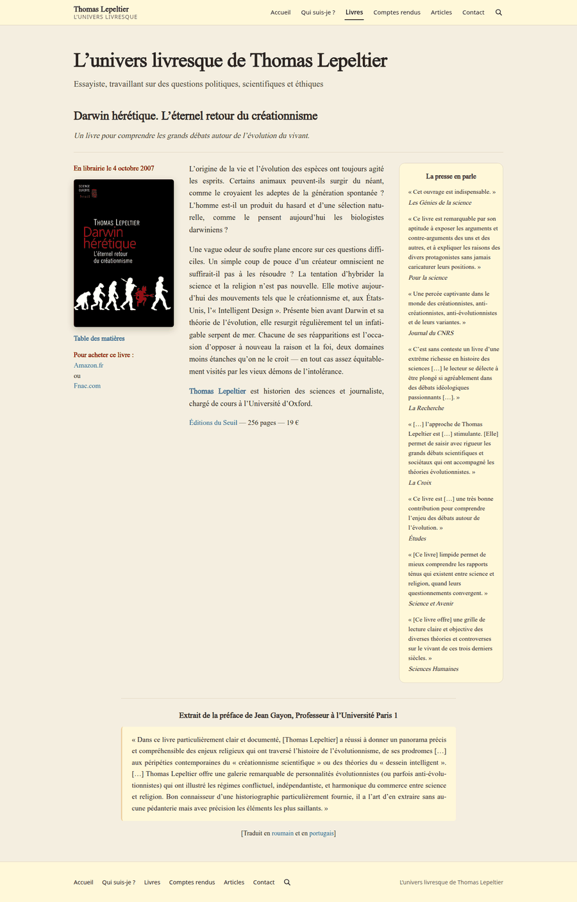 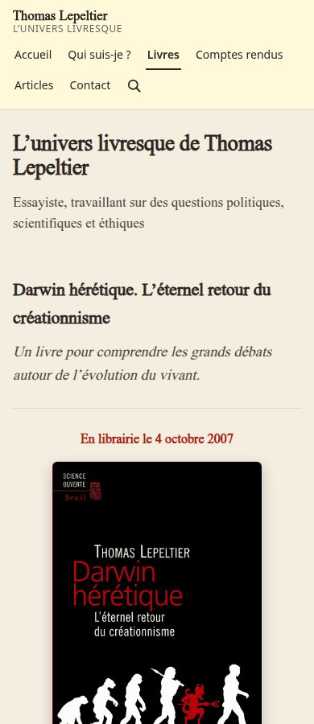

La page la mieux composée. Grille 3 zones : colonne gauche (date « En librairie… » en rouge, couverture 230 px, « Table des matières », liens d'achat Amazon/Fnac), colonne centrale justifiée (quatrième de couverture), encadré « La presse en parle » (crème, citations en italique). Sous les colonnes : extrait de préface en citation à filet sable, traductions. À 1 060 px l'encadré passe sous les deux colonnes ; sur mobile tout s'empile. Défauts : la colonne centrale s'arrête à ≈ 950 px alors que l'encadré de presse descend à ≈ 1 500 px (grand vide) ; aucune métadonnée structurée (ISBN, pages, prix tiennent dans une phrase) ; pas de lien « livre précédent/suivant ».
Table des matières (`darwin-heretique/contents.html`) : page quasi nue, 158 mots + couverture ; sous-pages similaires pour 6 livres.

### 3.6 Articles — 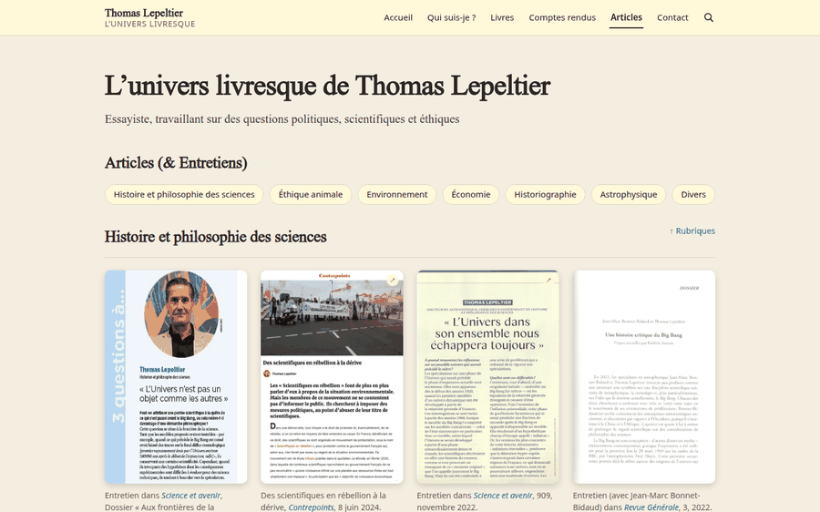

Titre h2 « Articles (& Entretiens) », rangée de 7 pastilles-rubriques (ancres), puis 7 sections h3 (Histoire et philosophie des sciences, Éthique animale, Environnement, Économie, Historiographie, Astrophysique, Divers) : **165 premières pages scannées** en grille 4 colonnes, légende sans-serif dessous. Les scans sont lisibles comme *objets* (la « une » du journal) mais **illisibles comme texte** (titre à 6 px dans l'image). 22 772 px de haut, 64 Mo d'images, lien « ↑ Rubriques » pour remonter. Pas de tri, pas de filtre, pas de pagination.

### 3.7 Conférences — 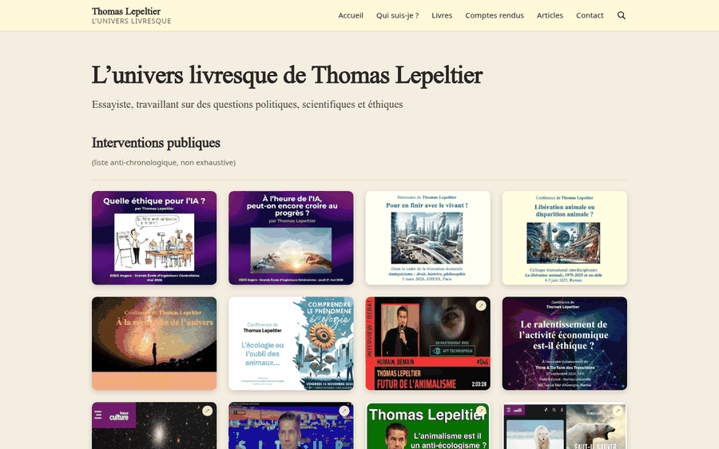

Titre « Interventions publiques » + « (liste anti-chronologique, non exhaustive) », puis 51 affiches en grille 4 colonnes (4:3), **19 Mo**. **Chaque affiche est un lien direct vers le fichier JPG** (`conferences.html:277`) : aucune page de détail (lieu, date, résumé, vidéo). Alt = nom de fichier pour 4 images (`alt="2026-quelle-ethique-pour-l-ia-apala.jpg"`). Aucun appel à l'action « Inviter Thomas ».

### 3.8 Contact

Un cadre crème pleine largeur contenant une adresse e-mail centrée. 54 mots, pas de formulaire, pas de réseaux, pas de photo. Page très vide (la moitié de l'écran).

### 3.9 Comptes rendus : index par auteur — 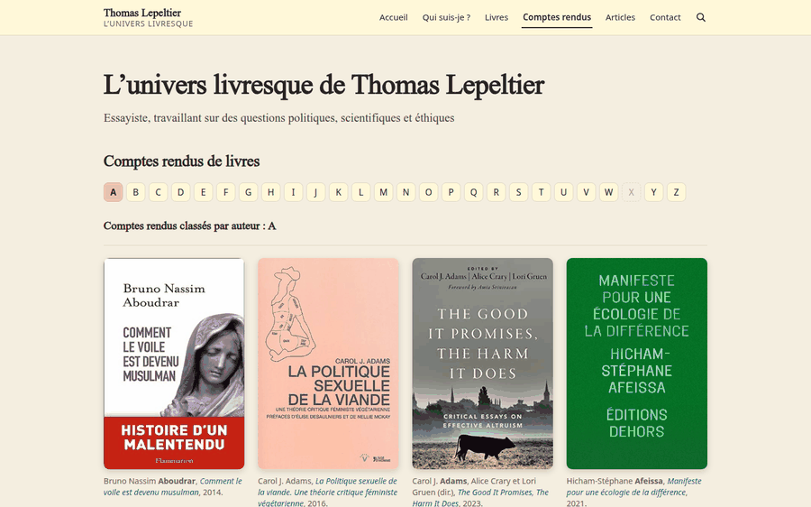 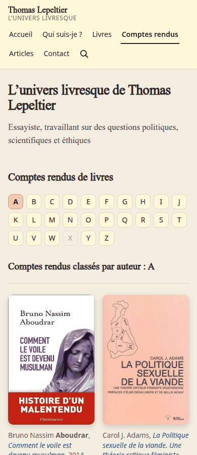

25 pages `auteurs/a_a.html … a_z.html` : alphabet en pastilles 34 px (30 px mobile ; X grisée), puis grille 4 colonnes de couvertures avec légende (« Auteur **Nom**, *Titre*, année ») ; 8 à 65 images par page. Très bon dispositif de navigation par lettre ; mais **pas de recherche intégrée à la page, pas de tri par année/thème**, et le comptage (« 528 comptes rendus ») n'est visible nulle part.

### 3.10 Compte rendu — 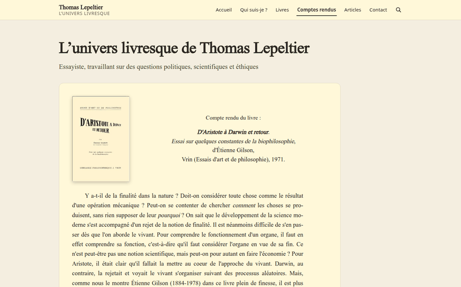 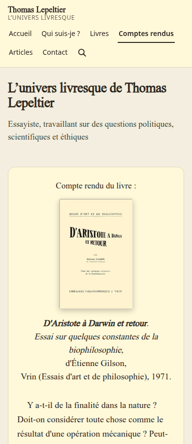

528 pages. Cadre crème de 880 px (alors que le bandeau et le pied font 1 072 px : le bord droit ne s'aligne pas, vide de ≈ 190 px à droite), couverture à gauche et bloc « Compte rendu du livre : *Titre*, de Auteur, Éditeur, année » **centré**, puis corps **justifié, retrait 40 px, césure automatique**, puis signature « Thomas Lepeltier, *Revue de livres*, janvier 1999. » avec lien vers `http://revue.de.livres.free.fr/` (domaine externe hérité). **La page n'a aucun titre (`h2` absent)**, aucune navigation (précédent/suivant, retour à la lettre), aucun lien d'achat ni vers l'auteur. Mobile : les quatre lignes de métadonnées empilées avant le texte.

### 3.11 Annexes et pages de texte long — 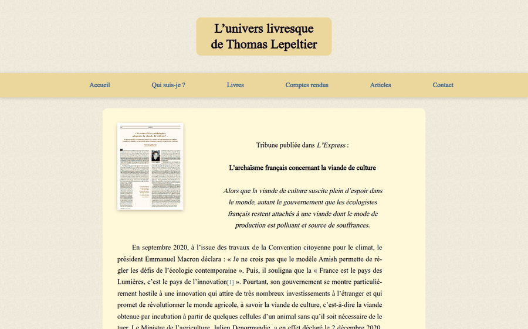

Annexes (6), débats (`autre-cosmos/debats.html`, 1 870 mots), textes sur le créationnisme (jusqu'à 3 770 mots) : même cadre crème 880 px, corps justifié (≈ 84 signes/ligne, **au-dessus de la limite de confort de 75**), note de navigation centrée (« Réponse 1 : … / Réponse 2 : … »), sans table des matières interne ni ancres.

### 3.12 Recherche — 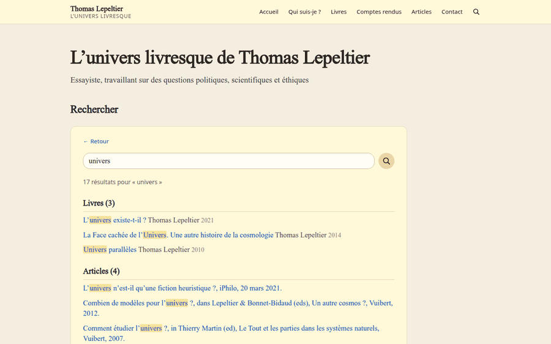

Page `recherche.html?de=…` : champ en capsule, bouton rond sable, résultats groupés (Livres (3), Articles (4), Comptes rendus…) avec surlignage jaune des termes. **Bonne conception** (insensible aux accents, résultats par catégorie, calculée côté client sans index à maintenir) ; mais la loupe est une icône seule sans libellé, le résultat apparaît seulement après *Entrée* (pas de saisie semi-automatique), le champ n'a pas d'`aria-label` (libellé visuel « Votre recherche » présent) et la page n'est pas reliée à une URL propre (`?de=` = page d'origine, pas la requête : une recherche ne peut pas être partagée).

### 3.13 Liste des publications — 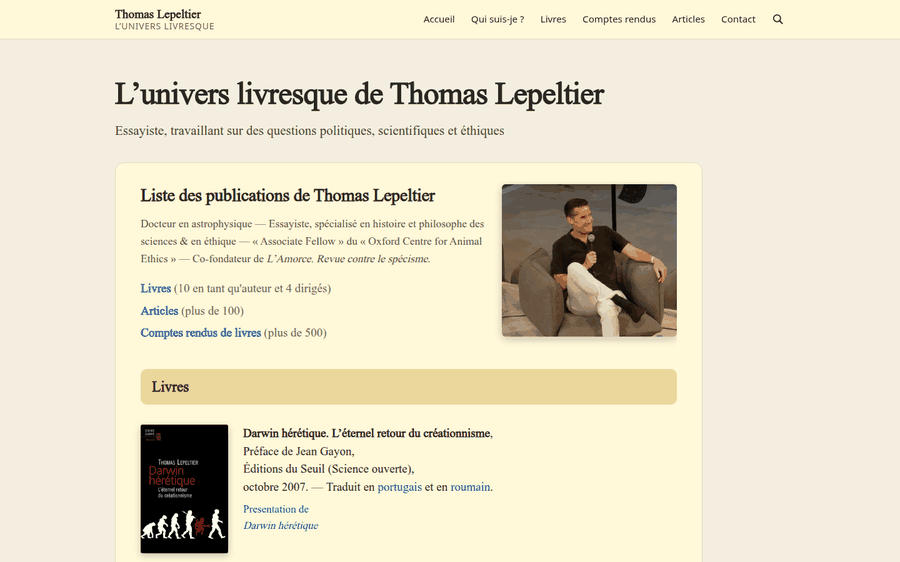

Page unique de **17 367 mots, 3 727 lignes de HTML, 787 liens, 51 700 px de haut** (98 000 px sur mobile) : en-tête, photo, trois liens d'ancre, puis sections h3 (Livres, Articles, Comptes rendus 1998-2000, Comptes rendus depuis 1999…) en listes. Elle **duplique** à elle seule les pages Livres, Articles et Comptes rendus, sans leurs couvertures. Ligne de 98 signes sur bureau.

### 3.14 Pages en ancien style — `articles/lecture/*.html`

Deux pages (`viande-de-culture-l-express.html`, `creationism-france.html`) utilisent encore `styles_new.css`, un doctype HTML 4.01 et l'ancien cadre (bloc titre sable centré, barre sable pleine largeur, liens bleus gras centrés, fond texturé, pas de recherche, pas de pied). L'une n'a ni `lang`, ni `viewport`, ni titre propre (`<title>` = « Articles »). Ces deux pages **contredisent visuellement** le reste du site.

---

## 4. Identité à préserver / daté à moderniser

### 4.1 IDENTITÉ À PRÉSERVER

| Élément | Pourquoi |
|---|---|
| **Papier chaud `#F4EEE0` + cadres crème `#FFF8D9` + sable `#EBD79B`** | Héritage direct de l'orange/jaune d'origine ; donne le ton « livre / bibliothèque » ; contrastes confortables (12,8:1 encre) |
| **Serif pour le texte et les titres** | Site d'un essayiste ; ton littéraire (cf. brief : « légèrement empattée ») |
| **Couvertures de livres en grille comme visuel principal** | Le contenu *est* l'identité (le brief : « les productions sont le cœur du site ») ; la grille de couvertures est la signature visuelle depuis l'origine |
| **Sobriété, absence de hero, aucune animation spectaculaire** | Conforme à la DA « brutalisme élégant » du brief |
| **Navigation par six rubriques lisibles** (Accueil, Qui suis-je ?, Livres, Comptes rendus, Articles, Contact) | Vocabulaire clair et ancien (SEO/mémoire) |
| **Alphabet des auteurs** (pastilles A-Z) | Dispositif propre au site, très efficace pour 528 CR |
| **« L'univers livresque »** (nom/baseline) | Marque éditoriale du site |
| **Encadré « La presse en parle »**, citations en italique | Valeur de preuve sociale déjà en place (cf. brief : commentaires sur la moitié des livres) |
| **Recherche par catégories avec surlignage** | À conserver comme comportement |
| **Ombre douce sur les couvertures** | Effet « objet posé sur le papier » cohérent avec le fond |

### 4.2 DATÉ OU FAIBLE À MODERNISER

| Élément | Constat |
|---|---|
| H1 = nom du site sur chaque page | Gabarit des années 2000 ; écrase le titre réel (DES-03) |
| CSS recopié dans chaque page, 2 gabarits | Dette technique (DES-04) |
| Polices système non embarquées | Rendu imprévisible (DES-07) |
| Vignettes forcées en 2:3 / 4:3 par `object-fit: fill` | Déformation (DES-02) |
| Pages-fleuves non paginées / non filtrables | DES-01, DES-11 |
| Texte justifié + césure, retrait de 40 px, centrage partiel | Style imprimerie mal transposé au web (DES-13) |
| Cartes sans titre, liens directs vers des JPG | DES-10 |
| Liens non soulignés | DES-05 |
| Aucun état de focus, aucun saut au contenu, aucune préférence de mouvement | DES-06 |
| Barre mobile à 3 lignes | DES-08 |
| Pied de page = copie du menu | Peu d'information (pas de mentions, réseaux, APALA, copyright : cf. brief) |
| Page Contact et Qui suis-je squelettiques | Manque de côté humain exigé par le brief |

---

## 5. Constats numérotés

Chaque constat : sévérité · fait · recommandation. Les références `fichier:ligne` portent sur le miroir du site vivant (`/tmp/audit_live/mirror/`, mêmes chemins que sur le site).

### Critique

**DES-01 · Critique · Pages-listes démesurées (poids et longueur).**
`articles.html` : 165 images = **64,4 Mo**, 68 images > 300 Ko (certaines 1,9 Mo, 2390×3345 px, affichées à 250 px), 305 liens, 22 772 px de haut (33 876 px mobile). `conferences.html` : 51 images, 19 Mo ; `livres.html` : 6,5 Mo ; format : 658 JPG, 91 PNG, 24 WebP seulement. Aucune pagination ni filtre. `loading="lazy"` est bien présent (`articles.html` : 0 image non différée), ce qui évite le pire en réseau, mais le fichier reste ingérable : scroll interminable, page indexable mais non navigable.
**→ Refonte :** générer les vignettes à la compilation avec `@11ty/eleventy-img` (AVIF/WebP, `srcset` 250/500/750 px, `width`/`height` renseignés) — poids visé < 150 Ko par grille de 12 vignettes ; paginer ou filtrer (rubrique, année, auteur) ; déplacer les scans pleine taille dans une visionneuse (lien « voir l'original »). Cible : `articles` < 1,5 Mo par page.

### Majeur

**DES-02 · Majeur · Vignettes déformées (`object-fit: fill`).**
Sur les grilles, `.carte img { aspect-ratio: 2/3; object-fit: fill }` (`index.html:209-215`, `articles.html:264-266`, `auteurs/a_a.html:259-266`) étire chaque image dans une tuile 2:3. Le commentaire du CSS affirme une déformation de « −7 % à +5 % » ; **mesure réelle sur 884 vignettes : 36 % déformées de plus de 5 %, 14 % de plus de 10 %, 5 % de plus de 15 %** (pires cas : +21 % de largeur sur la couverture d'Afeissa 1000×1821 ; −15 % sur le scan « interview-big-bang-sciences-et-avenir-1.webp » ; jusqu'à +35 % sur `mepris-animaux-racisme.jpg` et les images `a_venir.png`). Une couverture de livre déformée est une atteinte à l'œuvre d'autrui. Le commentaire du CSS note que « cover » rognerait, « contain » ajouterait des bandes, « fill » déforme : le choix a été fait en faveur du plus mauvais pour les couvertures.
**→ Refonte :** `object-fit: contain` sur fond papier avec `aspect-ratio` libre, ou, mieux, **hauteur de rangée commune et largeur naturelle** (masonry/`flex` aligné en bas, voir `src/docs/masonry.md` du projet) ; pour les scans d'articles, recadrer *à l'export* (haut de la première page) plutôt qu'à l'affichage. Interdire `fill` dans la feuille.

**DES-03 · Majeur · Le `h1` est le nom du site sur 590 pages ; le titre réel est un `h2` ou n'existe pas.**
Exemples : `cr/gilson.html:316` (h1 du site, aucun h2), `liste-des-publications.html:335` (h1 site → h2 « pub-h1 » `:345` → h3), `darwin-heretique.html` (titre du livre en h2). Les 528 comptes rendus n'ont **aucun titre propre**. Taille : le h1 (≈ 50 px) est deux fois plus grand que le titre de page (≈ 28 px) ; sur mobile il occupe deux lignes + chapeau avant tout contenu (≈ 280 px avant le premier titre utile). La page d'accueil seule devrait porter le nom du site en h1 ; sur les autres, c'est la marque (petite, en barre).
**→ Refonte :** un seul `h1` par page = titre de la page (titre du livre, du CR, de la rubrique) ; le nom du site reste dans la barre (élément `<a>` non titre) ; le chapeau « Essayiste… » n'apparaît que sur l'accueil (ou dans le pied). Titre `<title>` : `Titre de la page — Thomas Lepeltier` (aujourd'hui `Site de Thomas Lepeltier : Livres`, etc., 1 doublon).

**DES-04 · Majeur · Aucun système de design partagé : CSS recopié dans chaque page ; deux gabarits.**
588 pages portent leur propre `<style>` (de 190 à 480 lignes : `index.html:36-232`, `cr/gilson.html:36-300`, `darwin-heretique.html`…), 2 pages chargent `styles_new.css` (58 Ko) avec un autre design (§3.14). Corriger un détail (couleur, marge) = modifier 590 fichiers ; le cache navigateur ne sert à rien. Des commentaires en tête de style adressés à la personne qui a fait la maquette (« votre feuille de style », « Pour revenir en arrière… ») sont livrés en production.
**→ Refonte :** une seule feuille compilée (tokens + composants : barre, carte, grille, cadre, pastille, citation), gabarits Nunjucks `base`/`page`/`livre`/`chronique` (déjà amorcés dans `src/_layouts/`), suppression de tout CSS inline ; commentaires de travail retirés.

**DES-05 · Majeur · Liens indistinguables du texte hors survol.**
`a { color: var(--lien); text-decoration: none }` (`index.html:66`, `cr/gilson.html:66`) : dans un paragraphe, le bleu `#1449c4` ne se distingue du texte `#2B2721` que par **1,96:1** (WCAG 1.4.1 exige soit 3:1, soit un indice non chromatique). Le souligné n'apparaît qu'au survol (`:67`), donc jamais au tactile. Visible sur `qui-suis-je.html` (« Oxford Centre for Animal Ethics ») et les fiches (« Amazon.fr », « Fnac.com »).
**→ Refonte :** liens de contenu toujours soulignés (`text-decoration: underline; text-underline-offset: .18em; text-decoration-thickness: 1px`) ; supprimer le souligné seulement dans la navigation, où le contexte suffit. (Détail et critère dans le volet accessibilité.)

**DES-06 · Majeur · États interactifs incomplets (focus, mouvement, saut de navigation).**
Zéro règle `:focus`/`:focus-visible` dans les 590 pages ; l'indicateur du navigateur subsiste mais sur fond crème il peut être peu visible, et les cartes-images (liens entièrement graphiques) n'ont aucun style de focus propre. Aucun lien « Passer au contenu ». Le survol des cartes translate l'image de 3 px (`index.html:197-198`) sans `@media (prefers-reduced-motion: reduce)`. Barre collante de 63 px susceptible de masquer l'élément focalisé (guideline « sticky UI must not hide focus » : ajouter `scroll-padding-top`).
**→ Refonte :** `:focus-visible { outline: 3px solid var(--focus); outline-offset: 3px }` (2 couleurs séparables, 3:1 mini), lien d'évitement `<a class="skip">`, `scroll-padding-top: 5rem`, `@media (prefers-reduced-motion: reduce) { * { transition: none; animation: none } }`.

**DES-07 · Majeur · Typographie dépendante de polices non embarquées.**
`font-family: Charter, Georgia, "Times New Roman", serif` : Charter n'existe que sur macOS/iOS, Georgia sur Windows/macOS ; Android et Linux retombent sur un Times générique (c'est ce qu'ont montré les captures). Le titre en 50 px à `letter-spacing: -0.015em` y est le plus affecté. La partie sans-serif (`system-ui`) varie aussi (Segoe UI, SF, Roboto, Noto). L'identité littéraire est donc **aléatoire selon l'appareil**.
**→ Refonte :** embarquer une police serif de texte (WOFF2, `font-display: swap`, sous-ensemble latin + français, `<link rel="preload">`) : *Source Serif 4*, *Literata*, *Newsreader* ou *Charis SIL* (la plus proche de Charter). Garder un sans neutre pour l'interface (*Inter* variable ou pile système). Définir des tailles fluides `clamp()` sur une échelle modulaire.

**DES-08 · Majeur · Barre de navigation : trois lignes sur mobile, deux lignes sur tablette, pas de menu repliable.**
Hauteur mesurée : 63 px (≥ 1 000 px), **96 px à 768 px (sticky, 2 lignes)**, **137 px à 390 px (static, 3 lignes)** (`index.html:168-177`). Sur mobile le menu n'est pas collant (choix assumé), donc dès qu'on défile on perd la navigation ; sur tablette il l'est et mange 96 px. Les cibles font 42×36 px (OK) ; la loupe 23×33 px (étroite) ; liens de pied 38×22 px (juste en dessous de 24 px de haut).
**→ Refonte :** sous 760 px, barre d'une ligne (marque + bouton « Menu » `aria-expanded` + loupe), panneau déroulant ; au-delà, une seule ligne. Conserver la barre collante *mince* (≤ 56 px). Cibles ≥ 44×44 px sur tactile.

**DES-09 · Majeur · Mesure trop longue sur plusieurs gabarits.**
Caractères par ligne mesurés à 1440 px : annexes **85**, texte long **84**, débats **84**, **liste des publications 98**, CR 76, fiche 51. L'idéal pour du texte long est 45–75. Le CR est à la limite (`max-width: 38em ≈ 72 signes` voulu au CSS mais atteint 76 à 19 px), les annexes ne bornent pas la largeur du texte (cadre de 880 px).
**→ Refonte :** `max-width: 68ch` sur tout bloc de lecture, centrage de la colonne, marges latérales variables ; reste de la largeur (≈ 380 px) utilisable pour une table des matières latérale sur les longs textes.

**DES-10 · Majeur · Cartes sans titre et cibles de lien sans page : l'information est dans l'image.**
Livres, conférences et articles sont des **vignettes cliquables sans titre en texte** (`index.html:262-265`, `conferences.html:277`). Conséquences : (a) pas de scannabilité (Krug : reconnaître vs rappeler) — on ne sait pas de quoi parle un livre sans lire la couverture ; (b) **les affiches de conférence et plusieurs « articles » ouvrent un fichier JPG brut** (`index.html:287`, `index.html:295-298`, `conferences.html:277…`) : impasse sans retour, sans titre, sans lieu ni date, sans lien vers vidéo ; (c) les scans d'articles sont illisibles comme texte ; (d) le seul indice d'un lien externe est la pastille « ↗ » masquée aux technologies d'assistance (`index.html:273`, `aria-hidden="true"`) ;
**→ Refonte :** **carte = visuel + titre (h3) + méta (année, support) + type** ; `Carte livre`, `Carte article`, `Carte intervention` ; une page de détail par intervention (titre, date, lieu, résumé, média, tags) ; pour les liens sortants, texte « (nouvel onglet) » en `visually-hidden` + icône ; légende avec le titre du CR/article en toutes lettres (indexation et recherche).

**DES-11 · Majeur · La « Liste des publications » duplique le site et pèse 51 700 px.**
`liste-des-publications.html` : 17 367 mots, 787 liens, 3 727 lignes, mesure 98 signes. Les mêmes données existent sous forme de grilles (Livres/Articles/CR) : double maintenance, double indexation, risque de contenus divergents (ex. liens cassés `cr/wilson-genesis-…` et `annexes/tout-partie/tout_parties.html` présents ici et ailleurs). Ce n'est pas une page de lecture mais une base de données affichée à plat.
**→ Refonte :** la supprimer comme page de contenu ; la remplacer par une **vue « Liste »** générée depuis les mêmes données que les cartes (bascule grille/liste + tri année/auteur/rubrique) et un export (BibTeX/PDF) si nécessaire ; rediriger l'URL (cf. volet navigation).

**DES-12 · Majeur · Pages de CR et d'annexes : sans titre, sans contexte, sans navigation.**
`cr/gilson.html` : bloc de métadonnées centré, corps justifié, pas de `h2`, pas de précédent/suivant, pas de « autres CR de cet auteur », pas de lien vers le livre ni vers un lieu d'achat, pas de date de mise en ligne (seule la date de parution du CR dans la signature). Largeur du cadre 880 px contre 1 072 px pour la barre : décalage de bord droit visible (`cr/gilson.html:203`). Les annexes n'ont aucune table des matières interne.
**→ Refonte :** gabarit `chronique` : titre h1 = « Titre du livre — Auteur », méta (éditeur, année, date du CR, support d'origine) en `<dl>`, couverture non déformée, corps `68ch` aligné à gauche, pied de page éditorial (tags, « même auteur », précédent/suivant, retour à la lettre). Cadre aligné sur la grille du site.

### Mineur

**DES-13 · Mineur · Texte justifié + césure automatique + retrait de 40 px + centrage partiel.**
`.presentation p` (`darwin-heretique.html:265`), `.complement p` (`:303`), blockquote (`:309`), CR (`cr/gilson.html:265`, `text-indent: 40px`). Le justifié génère des « rivières » sur colonnes étroites (≈ 51 signes pour les fiches) et la césure n'est pas fiable partout ; le retrait de 40 px cohabite avec des alinéas séparés par marge (double marquage) ; les métadonnées sont centrées alors que le texte est justifié.
**→ Refonte :** `text-align: left`, `hyphens: manual`, interligne 1,6–1,7, paragraphes séparés par une marge (pas de retrait) ; réserver `justify` à un éventuel mode « lecture » opt-in.

**DES-14 · Mineur · Contraste du gris secondaire sur le sable.**
`#6B6355` sur `#EBD79B` = **4,16:1** (< 4,5:1) ; utilisé en légende de pastille/étiquette de bouton quand le fond est sable. Hors sable, le gris passe (5,1–5,6:1).
**→ Refonte :** gris secondaire `#5C5447` (6,45:1 sur papier, ≥ 5,5:1 sur sable) ; ne jamais poser le gris sur le sable.

**DES-15 · Mineur · Petites cibles et espacements.**
Liens de pied 38×22 px, lien « Tous mes livres → » 115–121×22–23 px, loupe 23×33 px, pastilles d'alphabet 30 px sur mobile. WCAG 2.2 (2.5.8) tolère 24×24 mais l'ergonomie tactile recommande 44×44.
**→ Refonte :** `min-height: 44px` pour les liens de navigation et d'action sur `pointer: coarse` ; loupe 44×44 avec libellé.

**DES-16 · Mineur · Bordures de composants trop faibles (non-texte).**
Champ de recherche et pastilles : bordure `#E0D6C2` = 1,25:1 sur papier ; WCAG 1.4.11 demande 3:1 pour la frontière d'un composant qui n'est pas distinguable autrement.
**→ Refonte :** bordure de champ `#8A7E64` (3,46:1 papier, 3,75:1 crème), garder `#E0D6C2` uniquement pour les filets décoratifs.

**DES-17 · Mineur · Aucune image n'a de dimensions explicites.**
0 % des images des grilles ont `width`/`height` (`index.html:262-299`), ce qui provoque du décalage de mise en page à l'arrivée des images (le `aspect-ratio` CSS réserve la boîte sur les grilles, mais pas sur la photo de `qui-suis-je.html` ni sur la couverture des CR).
**→ Refonte :** `eleventy-img` génère automatiquement `width`/`height` et `srcset`.

**DES-18 · Mineur · Pieds et en-têtes minces : nul rappel de l'identité, de la disponibilité ou des liens utiles.**
Pied = copie du menu + « L'univers livresque de Thomas Lepeltier » ; pas de réseaux sociaux, pas de mentions légales, pas de copyright, pas de lien APALA, pas de CTA conférences (tous exigés par `notes.md`). L'accueil n'a ni bio courte ni appel à inviter.
**→ Refonte :** pied en 3 colonnes (Explorer / Suivre / Contacter), mention d'invitation pour les conférences, lien APALA, mentions légales ; accueil : mini-bio + CTA.

**DES-19 · Mineur · Pages « maigres » : Contact et Qui suis-je.**
Contact : 54 mots, une adresse e-mail dans un cadre pleine largeur, le reste vide ; Qui suis-je : 182 mots sans intertitres ni chronologie. Le brief demande une bio « étayée » et un côté humain.
**→ Refonte :** Bio en sections (formation, histoire/philosophie des sciences, éthique animale, enseignement/journalisme), portrait + photo en situation, affiliations (Oxford Centre for Animal Ethics, L'Amorce) ; Contact avec CTA « Inviter pour une conférence », formulaire ou `mailto` pré-rempli, réseaux.

**DES-20 · Mineur · Incohérences de style résiduelles.**
(a) Rouge `#b3121d` seulement sur les fiches ; (b) trois formes de « pastille » (sable arrondi 14 px, 8 px, 50 %) ; (c) plusieurs variantes de gris (`#6B6355`, `#4A4437`, `#A8A093`) ; (d) `font-style: italic` utilisé comme balisage de titre dans les légendes (le moteur de recherche doit le reconstituer avec trois heuristiques : `recherche-moteur.js`, « les légendes marquent le titre de trois façons selon leur époque ») ; (e) sens de lecture du titre/h2 variable (centré dans les CR, à gauche ailleurs).
**→ Refonte :** une échelle de rayons (`--radius-s/m/l`), une palette fermée de 6 couleurs, le titre d'œuvre en `<cite>`, alignement à gauche systématique.

**DES-21 · Mineur · Images-placeholders et alt-nom-de-fichier.**
Image `a_venir.png` utilisée comme couverture de plusieurs entrées (`articles.html`, `auteurs/a_q.html`) ; 5 alt = nom de fichier (`conferences.html:277` etc.) ; 6 alt vides. Placeholder = signal de contenu inachevé visible par le visiteur.
**→ Refonte :** masquer les entrées sans visuel ou générer une carte typographique (titre sur fond sable) plutôt qu'une image « à venir » ; alt écrits (titre de l'intervention, lieu, date).

**DES-22 · Mineur · Pages en ancien style (2 pages).**
§3.14 : doctype HTML 4.01, pas de `lang`/`viewport` sur l'une, barre et cadre ancien, aucune recherche. Cohérence rompue.
**→ Refonte :** migrer ces deux textes (`articles/lecture/…`) dans le gabarit « texte long » ; ne plus charger `styles_new.css`.

### Points positifs à conserver (aucun constat)

Responsive sans débordement horizontal sur tous les gabarits ; `lang="fr"`, `<meta viewport>` correct (zoom non bloqué) ; points de repère sémantiques (`header`, `nav`, `main`, `footer`) sur 98 % des pages ; 100 % d'images avec `alt` ; `loading="lazy"` systématique ; typographie fluide `clamp()` ; espace insécable avant « ? » ; une seule propriété de transition ciblée ; pastilles alphabétiques adaptées au tactile ; bouton « La liste de mes publications » ; barre translucide collante sur bureau.

---

## 6. Application des grilles externes

### 6.1 Web Interface Guidelines (Vercel) — écarts observables

| Règle | Écart observé | Réf. |
|---|---|---|
| Visible focus / ne jamais retirer l'outline sans remplacement | Aucun style de focus ; sticky sans `scroll-padding` | DES-06 |
| Lien « Skip » | Absent | DES-06 |
| `prefers-reduced-motion` | Absent alors que survol animé | DES-06 |
| Images : `width`/`height` explicites | 0 % | DES-17 |
| Images : lazy en dessous du pli, prioritaires au-dessus | Tout est `lazy`, y compris l'en-tête visible de l'accueil (`index.html:262`) — pas de `fetchpriority="high"` sur les 4 premières couvertures | DES-01 |
| Headings dans l'ordre / hiérarchie | h1 = nom du site partout ; CR sans titre | DES-03, DES-12 |
| Boutons/liens avec état survol plus marqué | Présent (translation, sable) | ✅ |
| `transition: all` interdit | Non utilisé | ✅ |
| Icon-only avec nom accessible | Loupe : `aria-label="Rechercher"` ✅ ; pastille « ↗ » `aria-hidden` ✗ | DES-10 |
| Typographie : guillemets typographiques, ellipses, insécable | Apostrophes courbes ✅, « ? » avec insécable ✅ ; texte justifié + césure | DES-13 |
| `text-wrap: balance/pretty` pour titres | Absent (h1 en `nowrap` à 1440 px, repli brutal sur mobile) | DES-03 |
| Thème : `color-scheme`, `theme-color` | Absents (pas de mode sombre ; pas de `theme-color`) | §8 |
| Gros listings : virtualiser/paginer au-delà de 50 éléments | 165 vignettes, 787 liens sur une page | DES-01, DES-11 |
| URL reflète l'état (filtres, requête) | `recherche.html?de=…` n'encode pas la requête ; ancres seules pour les rubriques | DES-10 / navigation |
| Liens ouverts en nouvel onglet / indication | Liens sortants ouverts dans le même onglet, sans mention | DES-10 |
| Préconnexion aux domaines d'actifs / police | Pas de police embarquée | DES-07 |
| Contenu : libellés de boutons spécifiques | « Tous mes livres → » ✅, « Autres interventions → » ✅ | ✅ |

### 6.2 Heuristiques de Nielsen / lois de Krug

| Heuristique | Verdict | Constat |
|---|---|---|
| H1 Visibilité de l'état | Partiel | Page courante soulignée dans la barre ✅ ; pas de fil d'Ariane, résultat de recherche seulement après Entrée |
| H2 Correspondance avec le monde réel | ✅ | Vocabulaire clair (« Comptes rendus », « Livres ») |
| H3 Contrôle et liberté | Partiel | Lien « ← Retour » dans la recherche ✅ ; impasses sur JPG bruts ✗ (DES-10) |
| H4 Cohérence | ❌ | Deux gabarits, h1 identique, trois pastilles (DES-04, DES-20, DES-22) |
| H5 Prévention des erreurs | ✅ | Aucun formulaire |
| H6 Reconnaissance plutôt que rappel | ❌ | Couvertures sans titre, scans illisibles (DES-10) |
| H7 Flexibilité | Partiel | Recherche utile mais sans autocomplétion ; pas de tri/filtre (DES-01, DES-11) |
| H8 Design esthétique et minimaliste | Partiel | Sobre, mais titre de site répété, pied dupliquant le menu |
| H9 Aide à la récupération d'erreur | ❌ | 404 générique de l'hébergeur (« The page could not be found ») en `text/plain`, non habillée |
| H10 Aide et documentation | N/A | — |
| Krug : « Don't make me think » | ❌ | On ne sait pas ce qu'est une vignette avant de cliquer |
| Krug : conventions | ✅ | Menu horizontal, logo à gauche |
| Krug : texte réduit de moitié | ❌ | Liste des publications : 17 000 mots |
| Trunk test (où suis-je ?) | Partiel | Page courante soulignée ; titre de page absent sur les CR |

---

## 7. Rendu responsive (synthèse)

| Largeur | Observation |
|---|---|
| **1440 px** | Contenu 1 120 px centré, 4–5 colonnes de vignettes, barre 63 px. Aucun débordement. Cadre CR à 880 px non aligné sur la grille. |
| **768 px** | Barre de 96 px (menu sur 2 lignes, collante) ; grilles 4 colonnes de ≈ 160 px ; texte CR à 67 signes. |
| **390 px** | Barre statique 137 px (3 lignes) ; h1 sur 2 lignes ; grilles 2 colonnes (≈ 171 px par vignette) ; CR : 36 signes/ligne ; fiches empilées ; liste des publications ≈ 98 000 px de haut. Aucune règle `container query`, un seul vrai point de rupture (760 px) plus 560 px. |
| Zoom 200 % | Non testé en navigateur ; aucune largeur fixe en px dans les gabarits (`flex-wrap`, `clamp()`), mais la barre collante de 96 px à 768 px se réduit d'autant la fenêtre utile. |
| Orientation / grands écrans | Plafond à 1 120 px : à 1920 px les marges latérales font ≈ 400 px de chaque côté, sans filigrane ni structure (le brief prévoit un filigrane). |

**Recommandation :** conserver l'approche « fluide par `clamp()` » ; ajouter des `@container` pour les cartes ; points de rupture à 480 / 768 / 1080 / 1440 px ; barre repliable (DES-08).

---

## 8. Proposition de jetons de design cibles

À placer dans `src/assets/css/` (variables CSS, compatible avec `design-tokens.md` du projet). Les valeurs conservent l'identité (papier, crème, sable, encre) et corrigent les écarts mesurés.

```css
:root {
  /* Couleurs — palette fermée */
  --paper:      #F4EEE0;  /* fond (identité) */
  --cream:      #FFF8D9;  /* cadres, barre, pied (identité) */
  --sand:       #EBD79B;  /* boutons, état actif (identité) */
  --ink:        #2B2721;  /* texte — 12,8:1 */
  --ink-soft:   #5C5447;  /* secondaire — 6,45:1 papier, ≥ 5,5:1 sable (corrige DES-14) */
  --link:       #0F3FA8;  /* 8,57:1 sur crème, toujours souligné (DES-05) */
  --accent:     #7A1F2B;  /* bordeaux — 8,82:1 ; remplace #b3121d (étiquettes, citations) */
  --rule:       #E0D6C2;  /* filets décoratifs uniquement */
  --border-ui:  #8A7E64;  /* bordure de champ/composant — 3,46:1 (DES-16) */
  --focus:      #1A1A1A;  /* anneau de focus — 15:1, doublé d'un liseré --paper (DES-06) */

  /* Typographie */
  --font-serif: "Source Serif 4", Charter, Georgia, serif;   /* embarquée (DES-07) */
  --font-sans:  "Inter", system-ui, sans-serif;               /* interface */
  --step--1: clamp(.875rem, .85rem + .12vw, .95rem);
  --step-0:  clamp(1.125rem, 1.08rem + .2vw, 1.25rem);       /* ≈ 18–20 px */
  --step-1:  clamp(1.4rem, 1.3rem + .5vw, 1.75rem);
  --step-2:  clamp(1.75rem, 1.55rem + 1vw, 2.5rem);          /* h1 de page */
  --leading: 1.65;
  --measure: 68ch;                                           /* DES-09 */

  /* Espacement (échelle 4 px) */
  --space-1: .25rem; --space-2: .5rem; --space-3: .75rem; --space-4: 1rem;
  --space-6: 1.5rem; --space-8: 2rem;  --space-12: 3rem;  --space-16: 4rem;

  /* Formes */
  --radius-s: 6px; --radius-m: 10px; --radius-l: 14px;
  --shadow-cover: 0 4px 12px rgb(0 0 0 / .16);

  /* Mise en page */
  --container: 70rem;       /* 1120 px */
  --gutter: clamp(1rem, 3vw, 1.5rem);
  --header-h: 3.5rem;       /* barre collante mince, scroll-padding-top: calc(var(--header-h) + 1rem) */
  --tap: 2.75rem;           /* 44 px */

  /* Mouvement */
  --ease: cubic-bezier(.2,.6,.2,1); --t-fast: .16s;
}
@media (prefers-reduced-motion: reduce) { :root { --t-fast: 0s; } }
```

**Composants à construire** (avec leurs états) : Barre (desktop/mobile repliable), Carte livre / article / intervention (visuel `contain` + titre + méta), Grille (auto-fill, `minmax(11rem,1fr)`), Pastille/Filtre (alphabet, rubriques, tags), Cadre crème (`prose`, 68ch), Citation de presse, Fil d'Ariane, Liens externes (icône + texte masqué), Recherche (champ libellé, résultats groupés), Pied en 3 colonnes. **Règles** : un `h1` par page ; liens de contenu soulignés ; `object-fit: contain`/ratio natif jamais `fill` ; images via `eleventy-img` (AVIF/WebP, `width`/`height`) ; aucun CSS inline.

---

## 9. Annexes

**A. Mesures par type de page** (hauteur document en px à 1440 / 390 ; poids des images référencées) :

| Page | Hauteur 1440 | Hauteur 390 | Images | Poids images |
|---|---|---|---|---|
| index | 2 175 | 2 929 | 16 | 4,0 Mo |
| qui-suis-je | 1 019 | 1 560 | 1 | 0,11 Mo |
| livres | 2 896 | 5 140 | 32 | 6,5 Mo |
| fiche livre (Darwin hérétique) | 2 248 | 3 813 | 1 | 0,07 Mo |
| articles | 22 772 | 33 876 | 165 | **64,4 Mo** |
| conférences | 3 266 | 4 396 | 51 | **19,0 Mo** |
| auteurs/a_a | 3 473 | 5 320 | 23 | 1,3 Mo |
| auteurs/a_b | — | — | 65 | 3,7 Mo |
| compte rendu | 4 310 | 7 966 | 1 | 0,01 Mo |
| annexe longue | 7 911 | 16 392 | 0 | — |
| liste des publications | 51 716 | 98 107 | 18 | 5,7 Mo |

**B. Méthode et reproductibilité.** Scripts : `/tmp/audit_scripts/{shots.sh,measure.mjs,targets.mjs,imgw.py,distort.py,contrast.py,optimg.py}` (Python `-I`, Puppeteer sur Chromium 1248). Miroir servi sur `127.0.0.1:8765` (lecture seule). Contrastes calculés selon la formule WCAG 2.x (luminance relative).

**C. Renvois vers les autres volets.** Accessibilité (focus, contrastes, structure des titres, alternatives) : DES-05, DES-06, DES-14, DES-16, DES-21 ; navigation et URL (liste des publications, recherche partageable, 404, redirections `*.html` → URL propres) : DES-10, DES-11, §3.12 ; contenu (liens cassés des fiches/CR, mentions « chargé de cours à l'Université d'Oxford » à vérifier sur les fiches anciennes, domaine `revue.de.livres.free.fr` hérité) : DES-11, DES-12.
